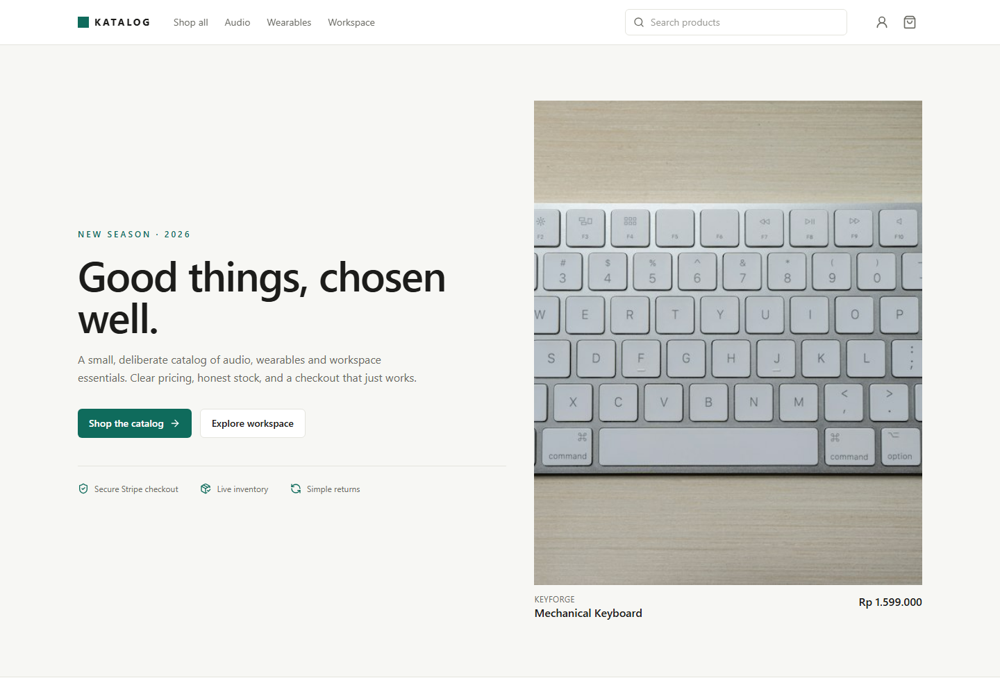
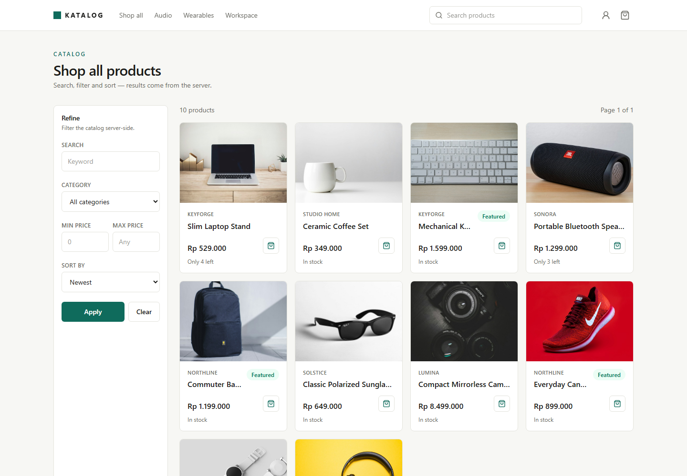
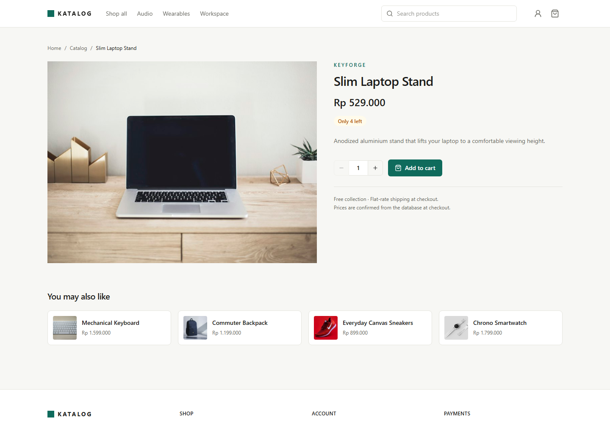
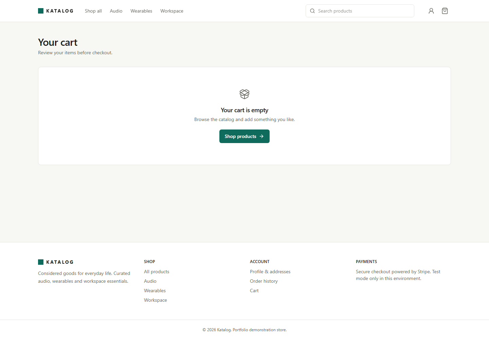

# E-Commerce Platform

A full-stack storefront and admin console built from the existing repository into a working, containerized application.

## Features

- Customer storefront: responsive catalog, search, category/price filters, sorting, pagination, product detail, featured products.
- Cart: guest cart in Redux, server-side cart for authenticated users, guest cart sync on login, server-calculated totals.
- Accounts: registration, login, profile, password change, multiple addresses, JWT session restore, 401 handling.
- Checkout: authenticated Stripe Checkout Sessions, server-owned prices, stock reservation, order lifecycle, cancellation, order history.
- Admin: role-protected console for products, categories, inventory adjustments and movements, low-stock monitoring, orders, status updates, and Mongo aggregation analytics.
- Platform: Docker Compose stack, healthchecks, persistent MongoDB volume, validation, rate limits, Helmet, CORS, structured errors, signed and idempotent Stripe webhook, transaction-backed inventory changes.

## Stack

| Layer | Technology |
|---|---|
| Frontend | Vite, React 19, React Router 7, Redux Toolkit, Tailwind CSS, Axios, Vitest |
| Backend | Node.js 20+, Express 5, Mongoose 9, express-validator, JWT, bcryptjs, Stripe 20, Jest |
| Database | MongoDB 8 |
| DevOps | Docker Engine, Docker Compose v5 |

## Quick start with Docker

```bash
cp .env.example .env
cp backend/.env.example backend/.env
cp frontend/.env.example frontend/.env
```

Edit the copied files. Set a long random `JWT_SECRET`; Stripe values can stay blank until payment testing.

```bash
docker compose up -d --build
docker compose exec -T backend npm run seed
```

Open:

- Storefront: `http://localhost:5173`
- API health: `http://localhost:5000/api/health`
- Seeded admin: `admin@example.com` / `admin12345`
- Seeded customer: `customer@example.com` / `customer12345`

Seed credentials are development defaults from `docker-compose.yml`; change them before any non-local deployment.

## Local development without Docker

Requirements: Node >= 20.19, npm, and MongoDB on `mongodb://localhost:27017/ecommerce`.

```bash
cd backend
cp .env.example .env
npm install
npm run dev
```

```bash
cd frontend
cp .env.example .env
npm install
npm run dev
```

The Vite dev server proxies `/api` to `VITE_API_PROXY_TARGET` (`http://localhost:5000` by default).

## Environment variables

| Variable | Used by | Purpose |
|---|---|---|
| `JWT_SECRET` | backend | Signs access tokens; required outside tests. |
| `JWT_EXPIRES_IN` | backend | Token lifetime; defaults to `1h` in tests. |
| `MONGODB_URI` | backend | MongoDB connection string. |
| `PORT` | backend | API port; defaults to `5000`. |
| `STRIPE_SECRET_KEY` | backend | Creates Checkout Sessions; `sk_test_...` only. |
| `STRIPE_WEBHOOK_SECRET` | backend | Verifies webhook signatures; `whsec_...`. |
| `STRIPE_PUBLISHABLE_KEY` | frontend | Browser Stripe key; `pk_test_...`. |
| `CLIENT_URL` / `CORS_ORIGIN` | backend | Redirect target and allowed browser origin. |
| `SHIPPING_FEE` / `TAX_RATE` | backend | Server-side order totals. |
| `RESERVATION_MINUTES` | backend | Pending-payment stock reservation window. |
| `ADMIN_SEED_EMAIL` / `ADMIN_SEED_PASSWORD` | backend seed | Bootstrap admin account. |
| `VITE_API_URL` | frontend | API base path; `/api` behind Vite proxy. |
| `VITE_API_PROXY_TARGET` | frontend | Dev-only proxy target. |

Do not commit real credentials. `.env` files are ignored; only `*.env.example` files are tracked.

## Stripe webhook testing

1. Set `STRIPE_SECRET_KEY` and `STRIPE_WEBHOOK_SECRET`.
2. Start the stack with `docker compose up -d --build`.
3. Run `stripe listen --forward-to localhost:5000/api/payments/webhook`.
4. Copy the printed `whsec_...` value into `STRIPE_WEBHOOK_SECRET` and restart the backend.
5. Complete checkout with a Stripe test card.

Checkout creation fails clearly when Stripe is not configured. Signed webhooks are verified with the raw request body, and duplicate events are ignored through `WebhookEvent`.

## Scripts

| Location | Command | Purpose |
|---|---|---|
| `backend` | `npm start` | Start API. |
| `backend` | `npm run dev` | Start API with nodemon. |
| `backend` | `npm run seed` | Seed categories, products, admin, and customer. |
| `backend` | `npm test` | Run Jest integration tests with in-memory MongoDB. |
| `frontend` | `npm run dev` | Start Vite dev server. |
| `frontend` | `npm run build` | Build production bundle. |
| `frontend` | `npm test` | Run Vitest unit/component tests. |
| root | `docker compose up -d --build` | Run the full stack. |

## Project structure

```text
backend/src/
├── config/          environment, database, Stripe
├── controllers/     HTTP adapters
├── middleware/      auth, RBAC, validation, rate limits, errors
├── models/          Mongoose schemas
├── routes/          /api route definitions
├── services/        catalog, cart, checkout, payment, inventory, order, analytics
├── utils/           response, money, AppError, asyncHandler
└── seed/            deterministic development data
frontend/src/
├── components/      layout and reusable UI
├── features/        Redux slices and thunks
├── pages/           customer and admin screens
├── routes/          protected/admin route guards
├── services/        Axios client and API modules
└── store/           Redux store configuration
docs/                audit, design docs, API reference, test report, screenshots
```

## Verification

```bash
cd backend && npm test
cd frontend && npm test && npm run build
docker compose config -q
docker compose up -d --build
docker compose ps
curl -fsS http://localhost:5000/api/health
```

Current production-dependency audits are clean (`npm audit --omit=dev`). Remaining advisories are dev-toolchain-only (Jest and Vitest transitive packages) and are recorded in `docs/testing-report.md`.

## Screenshots










## Documentation

- `docs/initial-audit.md`
- `docs/architecture.md`
- `docs/database-design.md`
- `docs/api-documentation.md`
- `docs/testing-report.md`
- `docs/implementation-log.md`
